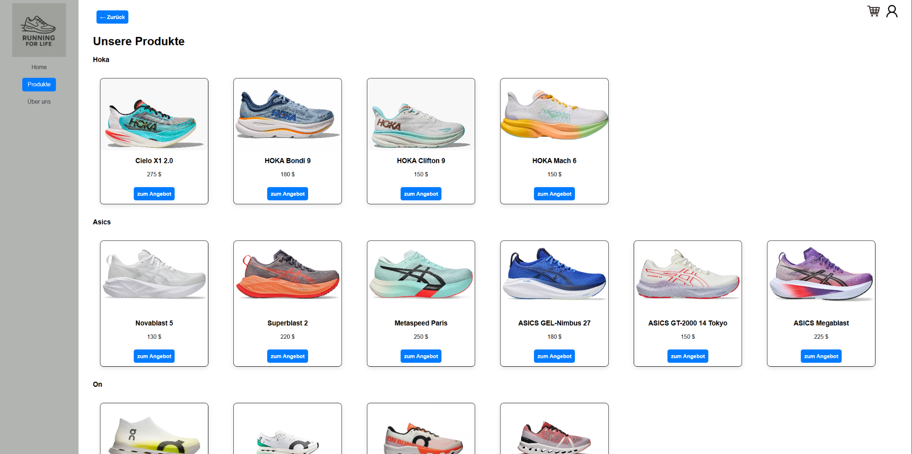

# Running for Life – Laufschuh-Onlineshop

Ein Full-Stack-Onlineshop für Laufschuhe, entstanden als Hochschulprojekt im Informatikstudium. Im Shop lassen sich Modelle verschiedener Marken vergleichen, Schuhgrößen auswählen und Produkte in den Warenkorb legen. Der Checkout ist an die PayPal-Sandbox angebunden.

**Stack:** Vue 3 und Vite · Java 17 und Spring Boot · JPA und PostgreSQL



## Funktionen

- Produktkatalog mit technischen Angaben wie Gewicht, Sprengung und Einsatzbereich
- Produktdetailseiten mit Größenauswahl und Kommentarfunktion
- Warenkorb, den das Backend über die Client-ID im Header `X-Client-Id` zuordnet
- Checkout mit PayPal-Sandbox und Adminbereich für die Nutzerverwaltung

<details>
<summary>Produktdetailseite ansehen</summary>


</details>

## Lokal starten (PowerShell)

Du brauchst Node.js mit npm, JDK 17 und PostgreSQL. Das Backend erwartet die Datenbank `shopdb` und den Benutzer `shop`.

**Datenbank vorbereiten.** Das Schema und die Produktdaten müssen bereits vorhanden sein. Das Skript `db/setup.sql` vergibt lediglich Berechtigungen. Für eine leere PostgreSQL-Instanz brauchst du daher zusätzlich das Datenbankschema und Produktdaten.

**Backend starten.** Führe diese Befehle im Repository-Hauptverzeichnis aus:

```powershell
cd shop_backend
$env:SPRING_DATASOURCE_PASSWORD = '<lokales Datenbankpasswort>'
# Fuer PayPal-Zahlungen zusaetzlich PAYPAL_CLIENT_ID und PAYPAL_CLIENT_SECRET setzen.
$env:MAVEN_OPTS = '-Djavax.net.ssl.trustStoreType=Windows-ROOT -Djavax.net.ssl.trustStore=NONE'
.\mvnw.cmd -DskipTests package
powershell.exe -NoProfile -ExecutionPolicy Bypass -File .\start.ps1
```

**Frontend starten.** Öffne ein zweites Terminal im Repository-Hauptverzeichnis:

```powershell
cd frontend
npm.cmd ci
npm.cmd run dev -- --host 127.0.0.1
```

Oeffne den [Shop](http://127.0.0.1:5173) im Browser. Die Produktdaten liefert die [REST-API](http://localhost:8080/api/products).

Die Backend-Startklasse liegt unter `shop_backend/src/main/java/com/example/shop_backend/ShopBackendApplication.java`.

## Projektstruktur

| Pfad | Inhalt |
| --- | --- |
| `frontend/` | Vue-Anwendung mit Vite und eigenem npm-Build |
| `shop_backend/` | Spring-Boot-REST-API mit Maven Wrapper |
| `db/` | SQL-Skript für Datenbankberechtigungen |

Es gibt kein Maven-Projekt im Hauptverzeichnis. In IntelliJ `shop_backend/pom.xml` als Maven-Projekt importieren. Frontend und Backend werden separat gestartet.
## PayPal unter Windows

`shop_backend/start.ps1` startet die gebaute JAR mit dem Windows-Zertifikatsspeicher. Die TLS-Zertifikatspruefung bleibt aktiviert. Die JVM-Optionen gelten nur fuer den gestarteten Prozess. Die ExecutionPolicy-Option oben gilt ebenfalls nur fuer diesen PowerShell-Aufruf.

Die lokalen PayPal-Rueckleitungen verwenden standardmaessig `http://localhost:8080` fuer das Backend und `http://127.0.0.1:5173` fuer das Frontend. Andere Adressen koennen ueber `PAYPAL_APP_BASE_URL` und `PAYPAL_UI_BASE_URL` gesetzt werden; jeweils mit Protokoll und Port. Das Frontend unter der konfigurierten Adresse oeffnen, damit die Browser-Client-ID bei der Rueckkehr erhalten bleibt.

`PAYPAL_CLIENT_ID` und `PAYPAL_CLIENT_SECRET` muessen fuer die konfigurierte Sandbox gesetzt sein. Zugangsdaten gehoeren nicht ins Repository.
