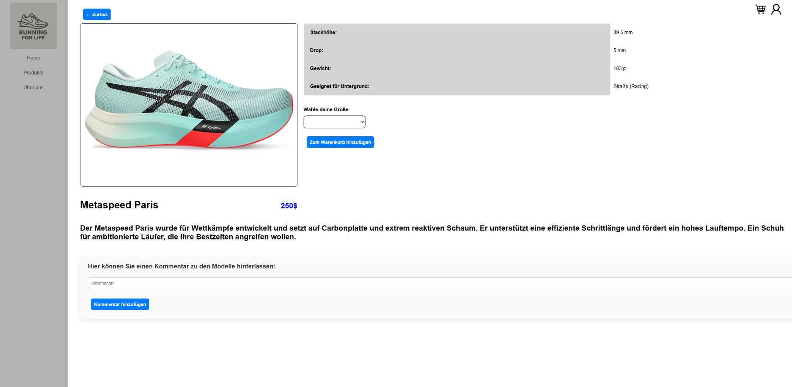

# Running for Life – Laufschuh-Onlineshop

Ein Full-Stack-Onlineshop für Laufschuhe, entstanden als Hochschulprojekt im Informatikstudium. Im Shop lassen sich Modelle verschiedener Marken vergleichen, Schuhgrößen auswählen und Produkte in den Warenkorb legen. Der Checkout ist an die PayPal-Sandbox angebunden.

**Stack:** Vue 3 und Vite · Java 17 und Spring Boot · JPA und PostgreSQL


## Funktionen

- Produktkatalog mit technischen Angaben wie Gewicht, Sprengung und Einsatzbereich
- Produktdetailseiten mit Größenauswahl und Kommentarfunktion
- Warenkorb, den das Backend über die Client-ID im Header `X-Client-Id` zuordnet
- Checkout mit PayPal-Sandbox und Adminbereich für die Nutzerverwaltung

<details>
<summary>Produktdetailseite ansehen</summary>



</details>

## Lokal starten (PowerShell)

Du brauchst Node.js mit npm, JDK 17 und PostgreSQL. Das Backend erwartet die Datenbank `shopdb` und den Benutzer `shop`.

**Datenbank vorbereiten.** Das Schema und die Produktdaten müssen bereits vorhanden sein. Das Skript `db/setup.sql` vergibt lediglich Berechtigungen. Für eine leere PostgreSQL-Instanz brauchst du daher zusätzlich das Datenbankschema und Produktdaten.

**Backend starten.** Führe diese Befehle im Repository-Hauptverzeichnis aus:

```powershell
cd shop_backend
$env:SPRING_DATASOURCE_PASSWORD = '<lokales Datenbankpasswort>'
# Für den Checkout zusätzlich PAYPAL_CLIENT_ID und PAYPAL_CLIENT_SECRET setzen.
.\mvnw.cmd spring-boot:run
```

**Frontend starten.** Öffne ein zweites Terminal im Repository-Hauptverzeichnis:

```powershell
cd frontend
npm.cmd ci
npm.cmd run dev
```

Öffne den [Shop](http://localhost:5173) im Browser. Die Produktdaten liefert die [REST-API](http://localhost:8080/api/products).

## Projektstruktur

| Pfad | Inhalt |
| --- | --- |
| `frontend/` | Vue-Anwendung mit Vite und eigenem npm-Build |
| `shop_backend/` | Spring-Boot-REST-API mit Maven Wrapper |
| `db/` | SQL-Skript für Datenbankberechtigungen |

Für die Backend-Entwicklung in IntelliJ kannst du `shop_backend/pom.xml` als Maven-Projekt importieren.
